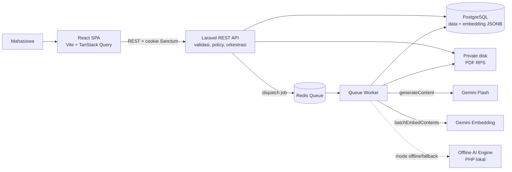
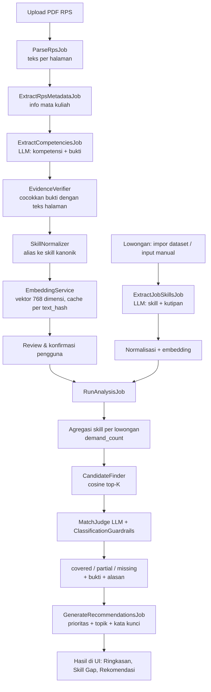

# SkillBridge

**Pemetaan kompetensi RPS terhadap kebutuhan skill industri berbasis AI.**

SkillBridge membaca dokumen RPS (Rencana Pembelajaran Semester) dalam format PDF, mengekstraksi kompetensi beserta kutipan buktinya, lalu membandingkannya dengan kebutuhan skill dari lowongan kerja nyata. Hasilnya berupa klasifikasi tiap skill industri (tercakup / tercakup sebagian / belum ditemukan dalam RPS) lengkap dengan bukti sumber, serta rekomendasi belajar mandiri untuk mahasiswa.

> SkillBridge **bukan** alat ukur kemampuan aktual mahasiswa. Status "belum ditemukan" hanya berarti skill tersebut belum ditemukan secara memadai di RPS yang dianalisis.

---

## Daftar isi

1. [Tim](#1-tim)
2. [Ringkasan aplikasi](#2-ringkasan-aplikasi)
3. [Fitur yang sudah diimplementasikan](#3-fitur-yang-sudah-diimplementasikan)
4. [Teknologi](#4-teknologi)
5. [Arsitektur dan alur data](#5-arsitektur-dan-alur-data)
6. [Instalasi dan menjalankan aplikasi](#6-instalasi-dan-menjalankan-aplikasi)
7. [Variabel lingkungan](#7-variabel-lingkungan)
8. [Akun demonstrasi](#8-akun-demonstrasi)
9. [Dokumentasi penggunaan AI](#9-dokumentasi-penggunaan-ai)
10. [Atribusi pihak ketiga](#10-atribusi-pihak-ketiga)
11. [Dokumentasi lanjutan](#11-dokumentasi-lanjutan)

---

## 1. Tim

**Nama tim:** wong_temenan

| No. | Nama | Keterangan |
|---|---|---|
| 1 | Alfian Rasyid El Fahmi | Ketua tim |
| 2 | Vicky Candra Arifian | Anggota |
| 3 | Daffa Eka Sujianto | Anggota |

Pembagian area kerja tim:

| Area | Cakupan |
|---|---|
| Backend Inti & Infrastruktur | Laravel API, database, auth, upload & parsing RPS, impor/scraping lowongan, deploy |
| AI Pipeline | Klien Gemini, ekstraksi kompetensi, embedding, matching, klasifikasi, rekomendasi, evaluasi |
| Frontend & UX | React SPA, desain UI, seluruh halaman dan komponen |

Rincian pembagian tugas ada di [`docs/TEAM.md`](docs/TEAM.md).

---

## 2. Ringkasan aplikasi

| | |
|---|---|
| **Kategori** | Web |
| **Nama aplikasi** | SkillBridge |
| **Target pengguna** | Mahasiswa pendidikan tinggi (rumpun Teknologi Informasi) yang ingin mengetahui keterkaitan mata kuliahnya dengan kebutuhan profesi tujuan |

### Masalah yang diangkat

- Kompetensi yang tertulis di RPS tidak terhubung langsung dengan kebutuhan profesi di industri.
- Mahasiswa sulit mengetahui keterampilan tambahan apa yang perlu dipelajari di luar perkuliahan.
- Membandingkan isi RPS dengan banyak lowongan kerja secara manual memakan waktu dan tidak konsisten.

### Solusi

1. Mahasiswa mengunggah RPS (PDF). Sistem mengekstraksi CPL, CPMK, Sub-CPMK, materi, rencana mingguan, dan tugas menjadi daftar kompetensi terstruktur. **Setiap kompetensi disertai kutipan bukti dari RPS** yang diverifikasi ulang terhadap teks halaman asli.
2. Mahasiswa meninjau hasil ekstraksi (setujui, edit, tolak, atau tambah kompetensi), lalu mengonfirmasinya.
3. Mahasiswa memilih profesi tujuan dan lowongan spesifik. Skill dari lowongan diekstraksi dan dinormalisasi ke kamus skill.
4. Sistem mencari kandidat kompetensi RPS yang paling mirip secara semantik (embedding + cosine similarity), lalu menilai cakupannya dengan LLM yang dibatasi aturan (guardrails) dan bukti.
5. Hasil ditampilkan sebagai ringkasan cakupan, tabel skill gap beserta bukti RPS dan kutipan lowongan, serta rekomendasi belajar berprioritas (topik dan kata kunci belajar, tanpa tautan yang tidak terverifikasi).

---

## 3. Fitur yang sudah diimplementasikan

| Fitur | Keterangan |
|---|---|
| **Autentikasi** | Registrasi, login, logout berbasis cookie SPA (Laravel Sanctum), guard sesi, rate limiting |
| **Upload RPS** | Dropzone di dashboard; validasi tipe isi PDF, ukuran, dan jumlah halaman; deteksi duplikat; PDF disimpan privat |
| **Parsing & metadata** | Teks diambil per halaman; deteksi PDF hasil scan (`needs_ocr`); ekstraksi otomatis info mata kuliah (nama, kode, SKS, semester, prodi) yang bisa dikoreksi pengguna |
| **Ekstraksi kompetensi** | Kompetensi dari CPL/CPMK/Sub-CPMK/materi/rencana mingguan/tugas, lengkap dengan kutipan bukti, halaman, dan status verifikasi (`verified`/`unverified`) |
| **Review kompetensi** | Setujui, edit, tolak, hapus, tambah kompetensi manual, lalu konfirmasi hasil ekstraksi sebelum analisis |
| **Profesi & lowongan** | 21 profesi rumpun TI; daftar lowongan dengan perusahaan, posisi, skill, dan sumber; form tambah lowongan manual |
| **Ekstraksi skill lowongan** | Skill, kategori, dan kutipan persyaratan dari deskripsi lowongan; kutipan disimpan persis dari teks asli |
| **Skill Gap Analysis** | Klasifikasi `covered`/`partial`/`missing` per skill industri, `demand_count` (jumlah lowongan yang meminta), persentase cakupan, dan panel bukti (kutipan RPS + kutipan lowongan + alasan) |
| **Rekomendasi belajar** | Prioritas `high`/`medium`/`low` berdasarkan status dan permintaan lowongan; topik dan kata kunci belajar; disclaimer |
| **Skill pribadi** | Mahasiswa dapat melaporkan skill yang dipelajari di luar RPS; skill tersebut dikeluarkan dari rekomendasi tanpa mengubah klasifikasi RPS |
| **Dashboard & profil** | Ringkasan RPS dan analisis, metrik, riwayat, pengelolaan skill pribadi |
| **Mode AI offline/fallback** | Pipeline tetap berjalan tanpa API key atau saat layanan AI terganggu, memakai mesin AI lokal di PHP |
| **Perintah CLI** | Impor/scraping lowongan, ekstraksi lowongan tertunda, evaluasi golden dataset (precision/recall/F1), simulasi alur |
| **Deploy** | Image Docker (API + web), GitHub Actions ke GHCR, compose produksi dengan backup & rollback |

---

## 4. Teknologi

### Frontend
| Teknologi | Versi | Fungsi |
|---|---|---|
| React | 19.3 | Library UI |
| Vite | 8.3 | Build tool & dev server |
| TypeScript | 7.0 (strict) | Bahasa |
| React Router | 7.18 | Routing SPA |
| TanStack Query | 5.107 | Data fetching, cache, polling status proses |
| Tailwind CSS | 4.3 | Styling |
| shadcn/ui (Radix UI) | radix-ui 1.8 | Komponen UI aksesibel |
| lucide-react | 1.72 | Ikon |
| Vitest + Testing Library | 5.1 | Unit/komponen test |

### Backend
| Teknologi | Versi | Fungsi |
|---|---|---|
| PHP | ≥ 8.3 | Bahasa |
| Laravel | 13.40 | REST API, queue, validasi, policy |
| Laravel Sanctum | 4.3 | Autentikasi SPA berbasis cookie |
| smalot/pdfparser | 2.13 | Ekstraksi teks PDF per halaman |
| predis | 3.7 | Client Redis |
| PHPUnit | 12.5 | Test |

### Database, infrastruktur, dan layanan pihak ketiga
| Teknologi | Fungsi |
|---|---|
| PostgreSQL 17 | Data utama; embedding disimpan sebagai `JSONB` |
| Redis 7 | Queue job AI dan cache |
| Docker & Docker Compose | Lingkungan dev (Postgres + Redis) dan deploy produksi |
| Nginx + PHP-FPM | Web server produksi |
| GitHub Actions + GHCR | Build dan publikasi image Docker |
| **Google Gemini API** | LLM Gemini Flash (ekstraksi JSON & penilaian) dan `gemini-embedding-001` (embedding 768 dimensi) |
| API lowongan publik | Sumber dataset lowongan (lihat [Atribusi](#10-atribusi-pihak-ketiga)) |

---

## 5. Arsitektur dan alur data

SkillBridge adalah **modular monolith**: satu backend Laravel (modul `Auth`, `Rps`, `Competency`, `Industry`, `Matching`, `Recommendation`, `Ai`) dengan frontend SPA terpisah. Semua proses AI berjalan **asinkron** di queue worker, sedangkan frontend memantau status lewat polling.

### Diagram arsitektur



### Alur data pipeline



Diagram sequence per operasi tersedia di [`docs/diagrams/`](docs/diagrams/) (indeks: [`docs/DIAGRAMS.md`](docs/DIAGRAMS.md)).

---

## 6. Instalasi dan menjalankan aplikasi

### Prasyarat

- PHP ≥ 8.3 dengan ekstensi `pdo_pgsql`, `mbstring`, `openssl`, `curl`, `zip`
- Composer 2
- Node.js ≥ 20 dan npm (terverifikasi dengan Node 24)
- Docker Desktop (untuk PostgreSQL + Redis)
- (Opsional) API key Google Gemini. Tanpa key, gunakan `SKILLBRIDGE_AI_MODE=offline`.

### Langkah

```bash
# 1. Clone dan masuk ke repo
git clone <url-repo> skillbridge && cd skillbridge

# 2. Jalankan PostgreSQL 17 + Redis 7 (db/user/password: skillbridge)
docker compose up -d

# 3. Backend
cd backend
composer install
cp .env.example .env
php artisan key:generate
#    edit .env: isi GEMINI_API_KEY + GEMINI_FLASH_MODEL, atau set SKILLBRIDGE_AI_MODE=offline
php artisan migrate --seed            # skema + kamus skill + 21 profesi + dataset lowongan + akun demo
php artisan serve                     # http://localhost:8000  (health check: /up)

# 4. Queue worker — WAJIB, terminal terpisah (semua proses AI berjalan di sini)
cd backend
php artisan queue:work redis --tries=3

# 5. Frontend — terminal terpisah
cd frontend
npm install
cp .env.example .env                  # VITE_API_URL=http://localhost:8000/api
npm run dev                           # http://localhost:5173
```

Buka **http://localhost:5173**. Gunakan `localhost`, bukan `127.0.0.1`, karena cookie sesi diatur untuk domain `localhost`.

> Setelah mengubah kode backend atau `.env`, restart `php artisan serve` dan **queue worker**. Worker tidak memuat ulang kode secara otomatis.

### Konfigurasi tambahan untuk fitur tertentu

**Upload PDF besar.** Default PHP (`upload_max_filesize=2M`, `post_max_size=8M`) menolak PDF sebelum sampai ke Laravel. Untuk batas `SKILLBRIDGE_MAX_PDF_MB=10`, atur di `php.ini` (dev) dan PHP-FPM (produksi), ditambah `client_max_body_size` di Nginx:

```ini
upload_max_filesize = 12M
post_max_size = 12M
```

**Dataset lowongan.** `php artisan db:seed` mengimpor dataset lowongan dari `parts/*.json` (bisa dimatikan dengan `SEED_PARTS_JOBS=false`) dan 8 lowongan **data contoh** fiktif (`backend/database/data/sample_jobs.json`) untuk demo. Untuk menambah atau mengekstraksi lowongan:

```bash
cd backend
# impor file CSV/JSON (validasi dulu dengan --dry-run)
php artisan skillbridge:import-jobs path/ke/lowongan.json --dataset-version=2026-11 --dry-run
php artisan skillbridge:import-jobs path/ke/lowongan.json --dataset-version=2026-11

# ambil lowongan TI dari API publik -> storage/app/private/scraped/*.json (tinjau, lalu impor)
php artisan skillbridge:scrape-jobs arbeitnow      # remotive | arbeitnow | himalayas | jobicy

# ekstraksi skill untuk lowongan yang masih pending (memakai AI, bertahap)
php artisan skillbridge:extract-pending-jobs --limit=25
```

Kolom impor: `career` (slug profesi), `company`, `title`, `description` (maks. 20.000 karakter), opsional `qualifications`, `source_name`, `source_url`, `collected_at` (`YYYY-MM-DD`), `dataset_version`. Satu baris tidak valid membatalkan seluruh impor; impor ulang baris yang sama memperbarui, bukan menduplikasi.

**Windows.** Bila muncul `cURL error 60` saat memanggil Gemini atau scraping, set `curl.cainfo` di `php.ini` ke file CA bundle (`cacert.pem`).

### Test dan pemeriksaan kode

```bash
cd backend  && php artisan test          # butuh Postgres + Redis aktif; panggilan Gemini selalu di-fake
cd frontend && npm run typecheck && npm run lint && npm test
```

### Deploy produksi

Aplikasi berjalan di **https://skillbridge.elfahmi.tech**. Deploy memakai image Docker dari GHCR (Nginx + PHP-FPM + worker + PostgreSQL + Redis). Panduan lengkap ada di [`docs/DEPLOY.md`](docs/DEPLOY.md).

---

## 7. Variabel lingkungan

Salin `backend/.env.example` → `backend/.env` dan `frontend/.env.example` → `frontend/.env`. Variabel bawaan Laravel (`APP_*`, `DB_*`, `REDIS_*`, `SESSION_*`, dll.) mengikuti default di file contoh. Variabel produksi tersedia di `deploy/prod/.env.example`.

### Frontend (`frontend/.env`)

| Variabel | Default | Keterangan |
|---|---|---|
| `VITE_API_URL` | `http://localhost:8000/api` | Base URL API. Terekspos ke browser, **jangan** isi rahasia. Di produksi: `/api` (same-origin) |

### Backend — SPA & auth

| Variabel | Default | Keterangan |
|---|---|---|
| `APP_URL` | `http://localhost:8000` | URL backend |
| `FRONTEND_URL` | `http://localhost:5173` | Origin frontend (CORS) |
| `SANCTUM_STATEFUL_DOMAINS` | `localhost:5173,127.0.0.1:5173` | Domain yang mendapat cookie sesi |
| `SESSION_DOMAIN` | `localhost` | Domain cookie sesi |
| `DB_*` | `pgsql`, `127.0.0.1:5432`, `skillbridge` | Koneksi PostgreSQL (sesuai `docker-compose.yml`) |
| `QUEUE_CONNECTION` / `CACHE_STORE` | `redis` | Queue dan cache memakai Redis |

### Backend — AI

| Variabel | Default | Keterangan |
|---|---|---|
| `SKILLBRIDGE_AI_MODE` | `gemini` | `gemini` (cloud), `offline` (mesin lokal PHP, tanpa key), `fallback` (cloud, otomatis ke lokal bila gagal) |
| `GEMINI_API_KEY` | — | **Rahasia, hanya di backend.** Jangan di-commit |
| `GEMINI_FLASH_MODEL` | — | Nama model Gemini Flash (mis. dari dokumentasi resmi Gemini) |
| `GEMINI_EMBEDDING_MODEL` | `gemini-embedding-001` | Model embedding |
| `GEMINI_EMBEDDING_DIMENSIONS` | `768` | Dimensi embedding; harus sama di kedua sisi perbandingan |
| `GEMINI_TIMEOUT_SECONDS` | `60` | Timeout per panggilan |

### Backend — matching, upload, dan batas

| Variabel | Default | Keterangan |
|---|---|---|
| `SKILLBRIDGE_TOP_K` | `3` | Jumlah kandidat kompetensi per skill industri |
| `SKILLBRIDGE_SIM_FLOOR` | `0.50` | Di bawah nilai ini skill langsung `missing` tanpa LLM. **Placeholder, belum terkalibrasi** |
| `SKILLBRIDGE_SIM_HIGH` | `0.80` | Ambang kemiripan tinggi. **Placeholder, belum terkalibrasi** |
| `SKILLBRIDGE_MAX_PDF_MB` | `10` | Ukuran maksimal PDF |
| `SKILLBRIDGE_MAX_PAGES` | `60` | Jumlah halaman maksimal |
| `SKILLBRIDGE_MIN_CHARS_PER_PAGE` | `50` | Di bawah ini halaman dianggap scan (`needs_ocr`) |
| `SKILLBRIDGE_AUTH_PER_MINUTE` | `5` | Rate limit login/registrasi |
| `SKILLBRIDGE_UPLOAD_PER_MINUTE` | `10` | Rate limit upload |
| `SKILLBRIDGE_PRIORITY_HIGH_DEMAND_RATIO` | `0.5` | Porsi lowongan yang dianggap permintaan tinggi untuk prioritas rekomendasi |

### Backend — dataset lowongan

| Variabel | Default | Keterangan |
|---|---|---|
| `SEED_PARTS_JOBS` | `true` | Impor `parts/*.json` saat `db:seed` |
| `PARTS_DATA_PATH` | `../parts` | Lokasi folder dataset |
| `SKILLBRIDGE_SCRAPER_USER_AGENT` | `SkillBridgeDatasetBot/1.0 (academic research)` | User-Agent scraper |
| `SKILLBRIDGE_SCRAPER_TIMEOUT` | `30` | Timeout scraper (detik) |
| `SKILLBRIDGE_SCRAPER_HIMALAYAS_COUNTRY` | `Indonesia` | Filter negara Himalayas |
| `SKILLBRIDGE_SCRAPER_JOBICY_GEO` | — | Filter geo Jobicy (opsional) |

---

## 8. Akun demonstrasi

| Lingkungan | URL | Email | Password |
|---|---|---|---|
| Demo online | https://skillbridge.elfahmi.tech | `<!-- TODO: email akun demo -->` | `<!-- TODO: password akun demo -->` |
| Lokal (setelah `php artisan migrate --seed`) | http://localhost:5173 | `test@example.com` | `password` |

Pengguna juga dapat membuat akun baru melalui halaman **Daftar**. Akun `test@example.com` hanya dibuat oleh seeder di lingkungan lokal; di produksi seeder dijalankan per kelas (lihat `docs/DEPLOY.md`), sehingga akun ini tidak tersedia di demo online.

---

## 9. Dokumentasi penggunaan AI

### 9.1 AI di dalam aplikasi

| Tahap | Model | Prompt | Fungsi |
|---|---|---|---|
| Metadata RPS | Gemini Flash | `rps-metadata-v1` | Nama, kode, SKS, semester, prodi mata kuliah |
| Ekstraksi kompetensi | Gemini Flash | `rps-extract-v1` | Kompetensi + kutipan bukti + jenis sumber + halaman |
| Ekstraksi skill lowongan | Gemini Flash | `job-extract-v1` | Skill + kategori + kutipan persyaratan |
| Embedding | `gemini-embedding-001` (768 dim) | — | Vektor kompetensi RPS dan skill lowongan |
| Penilaian kecocokan | Gemini Flash | `match-judge-v1` | Menilai kandidat top-K menjadi `covered`/`partial`/`missing` |
| Rekomendasi belajar | Gemini Flash | `reco-v1` | Judul, alasan, topik, kata kunci belajar |

Template prompt ada di [`backend/resources/prompts/`](backend/resources/prompts/). Detail pipeline: [`docs/AI_PIPELINE.md`](docs/AI_PIPELINE.md).

**Pengaman (guardrails) yang diterapkan:**

- **Bukti wajib dan diverifikasi.** Setiap kompetensi dan hasil pencocokan menyimpan `evidence`. Kutipan dicocokkan ulang ke teks halaman sumber; yang tidak cocok ditandai `unverified` dan halamannya tidak dipercaya.
- **Skor similarity hanya kandidat.** Klasifikasi akhir memakai aturan + penilaian LLM + bukti, dan skor tidak pernah ditampilkan sebagai persentase penguasaan.
- **Guardrails klasifikasi.** ID kandidat harus valid, nama teknologi harus muncul di bukti, kompetensi `unverified` maksimal `partial`, dan skor di bawah ambang langsung `missing` tanpa LLM.
- **Output LLM divalidasi** terhadap skema JSON sebelum disimpan; gagal validasi → retry terbatas → `failed`.
- **Input tidak tepercaya.** Isi PDF dan lowongan dibungkus delimiter di prompt, dan instruksi di dalamnya diabaikan.
- **Tanpa URL karangan.** Rekomendasi hanya berisi topik dan kata kunci, dan URL dibuang dari output.
- **Jejak audit.** Setiap panggilan AI dicatat di tabel `ai_runs` (purpose, model, versi prompt, hash input, latensi, token, status) tanpa menyimpan prompt atau API key. Versi model dan prompt tiap analisis disimpan di `analyses.model_versions`.
- **Embedding dibuat sekali** per kombinasi `text_hash + model + dimensi`, lalu dipakai ulang.
- **API key hanya di backend.**
- **Mode offline/fallback.** `OfflineAiEngine` (PHP lokal, berbasis aturan dan *feature hashing*) menjalankan seluruh pipeline tanpa layanan eksternal, untuk demo tanpa key atau saat kuota/koneksi Gemini bermasalah.
- **Evaluasi.** `php artisan skillbridge:evaluate` menghitung precision/recall/F1 terhadap golden dataset berlabel. Threshold similarity belum diklaim akurat sebelum dikalibrasi ([`docs/CALIBRATION.md`](docs/CALIBRATION.md)).

**Batasan:** hasil bergantung pada kelengkapan RPS, kualitas ekstraksi, dan relevansi data lowongan. PDF hasil scan tanpa text layer tidak dapat diproses (tidak ada OCR).

### 9.2 AI dalam proses pengembangan

Tim memakai model AI berikut sebagai asisten selama pengembangan:

| Model | Penyedia akses |
|---|---|
| Claude (Anthropic) | Claude |
| Gemini 3.8 Flash (Google) | Google |
| Gemini 4 Argon (Google) | Google |
| DeepSeek V4.1 Flash | ZaganRouter |

Dokumen spesifikasi di `docs/` (PRD, arsitektur, skema database, kontrak API, pipeline AI, rencana tugas, diagram sequence) dan `CLAUDE.md` disusun sebagai panduan kerja tim dan asisten AI. Asisten AI membantu menulis kode, test, dan dokumentasi berdasarkan spesifikasi tersebut. Seluruh hasilnya ditinjau tim, diuji dengan test otomatis (PHPUnit dan Vitest), dan digabung lewat pull request.

> Catatan: model di tabel ini adalah alat bantu pengembangan. Model yang dipanggil aplikasi saat berjalan diatur lewat variabel lingkungan (bagian 9.1 dan 7).

---

## 10. Atribusi pihak ketiga

### Dataset lowongan kerja

Dataset di `parts/*.json` (7.894 lowongan rumpun TI, dikumpulkan 10 November 2026) dan hasil `skillbridge:scrape-jobs` berasal dari sumber berikut. Setiap lowongan menyimpan `source_name` dan `source_url` asli yang ditampilkan di aplikasi sebagai atribusi. Hak cipta isi lowongan tetap milik perusahaan pemasang dan platform sumber. Data dipakai hanya sebagai sumber kebutuhan skill untuk keperluan akademik/non-komersial.

| Sumber | Jumlah | | Sumber | Jumlah |
|---|---|---|---|---|
| Greenhouse | 4.679 | | JobStreet | 117 |
| Ashby | 972 | | LinkedIn | 105 |
| Arbeitnow | 469 | | We Work Remotely | 84 |
| Glints | 429 | | Himalayas | 70 |
| Lever | 373 | | Workable | 47 |
| SmartRecruiters | 293 | | Remote OK | 32 |
| Jobicy | 193 | | Working Nomads | 26 |
| | | | Remotive | 5 |

Lowongan di `backend/database/data/sample_jobs.json` adalah **data contoh fiktif** buatan tim.

### Layanan

- **Google Gemini API**: Gemini Flash dan `gemini-embedding-001`, tunduk pada ketentuan layanan Google.

### Library dan framework

| Komponen | Lisensi |
|---|---|
| Laravel, Laravel Sanctum, predis | MIT |
| smalot/pdfparser | LGPL-3.0 |
| React, React Router, TanStack Query, Vite | MIT |
| Tailwind CSS, tw-animate-css, tailwind-merge | MIT |
| shadcn/ui (kode komponen di `frontend/src/components/ui/`), Radix UI | MIT |
| class-variance-authority, TypeScript | Apache-2.0 |
| lucide-react (ikon) | ISC |

Daftar lengkap dependency dan versinya ada di `backend/composer.lock` dan `frontend/package-lock.json`.

### Font dan aset

| Aset | Sumber | Lisensi |
|---|---|---|
| Plus Jakarta Sans | Google Fonts via `@fontsource-variable/plus-jakarta-sans` | SIL Open Font License 1.1 |
| DM Serif Display | Google Fonts via `@fontsource/dm-serif-display` | SIL Open Font License 1.1 |

Desain antarmuka (palet warna, layout halaman) dibuat oleh tim.

---

## 11. Dokumentasi lanjutan

| File | Isi |
|---|---|
| [`docs/PRD.md`](docs/PRD.md) | Produk, fitur, alur, batasan, kriteria MVP |
| [`docs/ARCHITECTURE.md`](docs/ARCHITECTURE.md) | Arsitektur, modul, queue, env |
| [`docs/DATABASE.md`](docs/DATABASE.md) | Skema PostgreSQL |
| [`docs/API.md`](docs/API.md) | Kontrak REST API |
| [`docs/AI_PIPELINE.md`](docs/AI_PIPELINE.md) | Ekstraksi, embedding, matching, klasifikasi, rekomendasi, prompt |
| [`docs/FRONTEND.md`](docs/FRONTEND.md) | Halaman, komponen, aturan kata-kata UI |
| [`docs/SECURITY.md`](docs/SECURITY.md) | Keamanan dan privasi |
| [`docs/TESTING.md`](docs/TESTING.md) · [`docs/CALIBRATION.md`](docs/CALIBRATION.md) | Strategi test, evaluasi, kalibrasi threshold |
| [`docs/DIAGRAMS.md`](docs/DIAGRAMS.md) | Diagram sequence per operasi |
| [`docs/DEPLOY.md`](docs/DEPLOY.md) | Deploy produksi dengan Docker |
| [`docs/VERSIONS.md`](docs/VERSIONS.md) | Versi runtime, framework, layanan |
| [`docs/TEAM.md`](docs/TEAM.md) · [`docs/TASKS.md`](docs/TASKS.md) | Pembagian tim dan rencana kerja |
| [`CLAUDE.md`](CLAUDE.md) | Aturan wajib dan konvensi kode |
