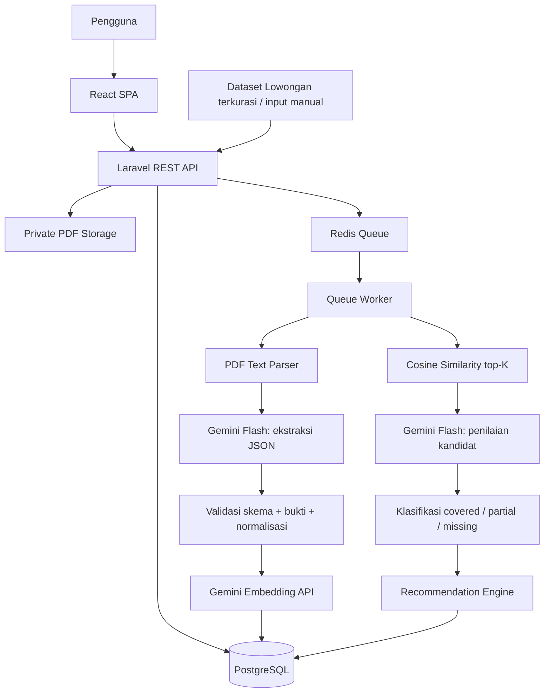

# Arsitektur SkillBridge

## 1. Pendekatan
**Modular monolith** dengan Laravel sebagai backend tunggal. Tidak ada service Python. Pemisahan tanggung jawab lewat modul logis.

## 2. Stack
| Lapisan | Teknologi | Tanggung jawab |
|---|---|---|
| Frontend | React (Vite SPA) + React Router + TypeScript | Upload, pemilihan lowongan, dashboard |
| UI | Tailwind CSS + shadcn/ui | Komponen dan styling |
| Backend | Laravel (REST API) | API, auth, orkestrasi AI, validasi, similarity, penyimpanan |
| Auth | Laravel Sanctum | Autentikasi SPA berbasis cookie |
| Database | PostgreSQL | Data utama + embedding `JSONB` |
| Queue | Redis + Laravel Queue | Pemrosesan asinkron |
| PDF | PHP PDF parser (`smalot/pdfparser`) | Teks per halaman untuk PDF digital |
| AI ekstraksi/penilaian | Gemini Flash (nama model di env) | JSON terstruktur |
| Embedding | `gemini-embedding-001`, 768 dimensi | Vektor kompetensi & skill |
| Similarity | Laravel/PHP | Cosine similarity, top-K kandidat |
| Storage | Disk lokal privat di VPS (di luar web root) | PDF privat |
| Deploy | VPS tunggal: Nginx, PHP-FPM, systemd/Supervisor, Redis, PostgreSQL | Hosting |

## 3. Diagram


## 4. Struktur backend (Laravel)
```
backend/app/
├── Modules/
│   ├── Auth/            # register, login, me, roles
│   ├── Rps/             # upload, parsing, competencies
│   │   ├── Actions/ Services/ Jobs/ Http/ Models/ Policies/
│   ├── Industry/        # careers, job postings, job skills
│   ├── Analysis/        # matching, classification, summary
│   ├── Recommendation/  # student & curriculum recommendations
│   └── Ai/              # GeminiClient, EmbeddingService, PromptRegistry, SchemaValidator
├── Support/             # helper (cosine, text normalization, hashing)
config/skillbridge.php   # threshold, top-K, model env, batas ukuran
```
Aturan: controller tipis → Action/Service; Service AI hanya diakses lewat `Modules/Ai`.

### Modul
- **Auth** — registrasi, login, role `student`/`study_program`.
- **Rps** — upload, simpan metadata, parsing halaman, ekstraksi & verifikasi kompetensi.
- **Industry** — profesi, lowongan, ekstraksi dan normalisasi skill lowongan.
- **Analysis** — pencocokan, klasifikasi, hitung cakupan.
- **Recommendation** — rekomendasi mahasiswa dan prodi.
- **Ai** — klien Gemini, embedding + cache, registry prompt/skema, pencatatan `ai_runs`.

## 5. Pemrosesan latar belakang

### Jobs
| Job | Pemicu | Tugas |
|---|---|---|
| `ParseRpsJob` | setelah upload | Ekstrak teks per halaman → `rps_pages`; set `parse_status` |
| `ExtractRpsMetadataJob` | setelah parse | Ambil nama/kode/SKS/semester/prodi (dapat diedit pengguna) |
| `ExtractCompetenciesJob` | pengguna konfirmasi metadata | LLM → kompetensi → validasi bukti → normalisasi → embedding |
| `ExtractJobSkillsJob` | lowongan disimpan | LLM → skill → normalisasi → embedding |
| `RunAnalysisJob` | `POST /api/analyses` | Top-K → penilaian → klasifikasi → ringkasan |
| `GenerateRecommendationsJob` | setelah analisis selesai | Rekomendasi `student` dan `study_program` |

Semua job: idempotent, `tries = 3`, `backoff` eksponensial, timeout eksplisit, method `failed()` mengubah status menjadi `failed` dengan pesan aman untuk pengguna. Pembatasan paralelisme job AI via rate limiter / `WithoutOverlapping` per dokumen.

### Alur
```
Upload RPS → store PDF → ParseRpsJob → ExtractRpsMetadataJob → [pengguna cek metadata]
→ ExtractCompetenciesJob → kompetensi siap
Pilih profesi + lowongan → POST /api/analyses → RunAnalysisJob → GenerateRecommendationsJob → hasil siap
```
Frontend polling status lewat `GET` (interval 2–3 detik, berhenti saat `completed`/`failed`).

### State machine
| Entitas | Status |
|---|---|
| `rps_documents.parse_status` | `pending` → `parsing` → `parsed` \| `failed` \| `needs_ocr` |
| `rps_documents.extraction_status` | `pending` → `processing` → `completed` \| `failed` |
| `job_postings.extraction_status` | `pending` → `processing` → `completed` \| `failed` |
| `analyses.status` | `queued` → `processing` → `completed` \| `failed` |

## 6. Konfigurasi & environment
```env
# AI
GEMINI_API_KEY=
GEMINI_FLASH_MODEL=            # isi nama model Flash yang tersedia saat implementasi
GEMINI_EMBEDDING_MODEL=gemini-embedding-001
GEMINI_EMBEDDING_DIMENSIONS=768
GEMINI_TIMEOUT_SECONDS=60

# Matching (placeholder, wajib dikalibrasi; lihat AI_PIPELINE.md)
SKILLBRIDGE_TOP_K=3
SKILLBRIDGE_SIM_FLOOR=0.50
SKILLBRIDGE_SIM_HIGH=0.80

# Upload
SKILLBRIDGE_MAX_PDF_MB=10
SKILLBRIDGE_MAX_PAGES=60
SKILLBRIDGE_MIN_CHARS_PER_PAGE=50

# Rate limit (register/login per email + IP)
SKILLBRIDGE_AUTH_PER_MINUTE=5
SKILLBRIDGE_UPLOAD_PER_MINUTE=10

# Infra
QUEUE_CONNECTION=redis
FILESYSTEM_DISK=private
DB_CONNECTION=pgsql
SANCTUM_STATEFUL_DOMAINS=
SESSION_DOMAIN=
FRONTEND_URL=
```
Semua nilai tersebut dibaca lewat `config/skillbridge.php`.

## 7. Deployment
Semua komponen berjalan di satu VPS (Linux):
- **Nginx:** menyajikan build statis frontend (`frontend/dist`, dengan fallback `try_files ... /index.html` untuk SPA routing) dan meneruskan `/api` + `/sanctum` ke PHP-FPM (Laravel `public/`). Env build frontend: `VITE_API_URL`.
- **PHP-FPM + Laravel:** API. `APP_ENV=production`, `APP_DEBUG=false`, cache config/route (`php artisan optimize`).
- **Queue worker:** `php artisan queue:work redis --tries=3` dikelola systemd atau Supervisor (auto-restart; restart setelah deploy via `php artisan queue:restart`).
- **Redis dan PostgreSQL:** terpasang di VPS, hanya listen ke localhost; tidak dibuka ke publik.
- **Storage PDF:** disk `private` Laravel, mis. `/var/www/skillbridge/storage/app/private`, di luar web root, izin hanya untuk user aplikasi.
- **HTTPS:** Certbot (Let's Encrypt). Firewall (ufw) hanya membuka 22, 80, 443.
- **Backup:** `pg_dump` terjadwal + salinan direktori storage ke lokasi di luar VPS.
- Cookie SPA Sanctum: paling mudah satu domain yang sama (Nginx merutekan `/api` ke Laravel, sehingga tanpa CORS), atau subdomain induk yang sama (`app.example.com` dan `api.example.com`). Lokal: `localhost`.
- Langkah deploy: `git pull`, `composer install --no-dev`, `php artisan migrate --force`, `php artisan optimize`, `npm ci && npm run build` di frontend, `php artisan queue:restart`.

## 8. Keputusan arsitektur
1. Satu backend Laravel.
2. Gemini Flash untuk JSON; Gemini Embedding untuk vektor.
3. Embedding di `JSONB`, cosine di Laravel (cukup untuk skala MVP: satu RPS ≈ puluhan–ratusan kompetensi).
4. Embedding dibuat sekali per versi teks/model dan dipakai ulang.
5. Bukti RPS wajib; skor similarity bukan klaim penguasaan.
