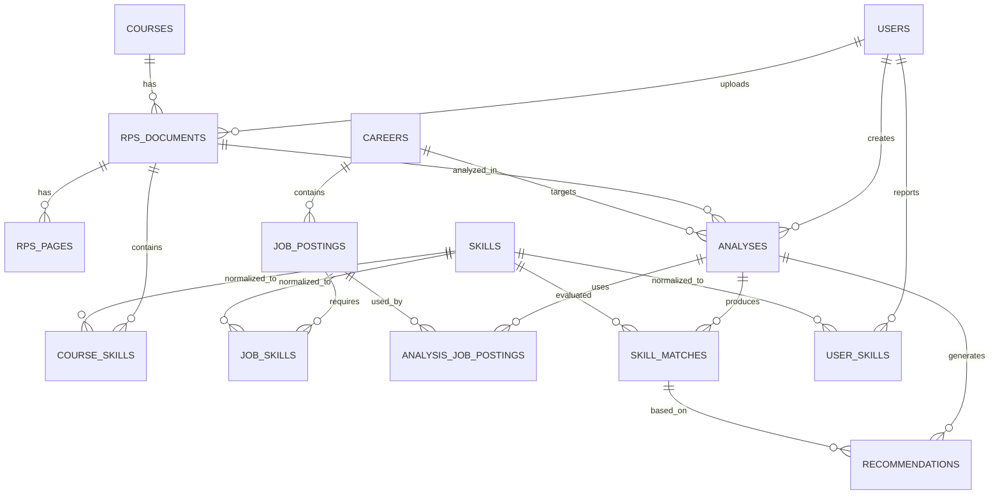

# Desain Database (PostgreSQL)

Semua tabel punya `id` (bigint, PK) dan `created_at`/`updated_at` kecuali dinyatakan lain. Nama kolom/tabel bahasa Inggris, snake_case.

## 1. Relasi

## 2. Tabel

### `users`
| Kolom | Tipe | Catatan |
|---|---|---|
| name | string | |
| email | string unique | |
| password | string | hash |
| role | string | selalu `student`, default `student` (role lain di luar MVP) |

### `courses`
| Kolom | Tipe | Catatan |
|---|---|---|
| code | string null unique | contoh `24060511D21`; unik global (identitas MK, dipakai ulang saat konfirmasi metadata). Banyak `null` diperbolehkan |
| name | string | |
| credits | smallint null | bobot SKS |
| semester | smallint null | |
| study_program | string null | |

### `rps_documents`
| Kolom | Tipe | Catatan |
|---|---|---|
| user_id | FK users | cascade |
| course_id | FK courses null | diisi setelah metadata dikonfirmasi |
| detected_metadata | jsonb null | draft metadata hasil `ExtractRpsMetadataJob` / koreksi `PATCH`, mis. `{code, name, credits, semester, study_program}`; tidak menyentuh `courses` |
| metadata_confirmed_at | timestamp null | diisi saat konfirmasi (`POST /api/rps/{id}/extract`) bersama `course_id`; gerbang ekstraksi kompetensi |
| original_name | string | |
| file_path | string | disk privat |
| file_hash | string(64) | SHA-256; deteksi duplikat per user |
| file_size | integer | byte |
| page_count | smallint null | |
| parse_status | string | `pending\|parsing\|parsed\|failed\|needs_ocr` |
| extraction_status | string | `pending\|processing\|completed\|failed` |
| review_status | string | `unreviewed\|confirmed`, default `unreviewed`; analisis mensyaratkan `confirmed` |
| reviewed_at | timestamp null | waktu konfirmasi hasil ekstraksi |
| error_message | text null | pesan aman untuk pengguna |

Indeks: `user_id`, unique(`user_id`, `file_hash`).

### `rps_pages`
| Kolom | Tipe | Catatan |
|---|---|---|
| rps_document_id | FK | cascade |
| page_number | smallint | |
| text | text | teks halaman (dipakai verifikasi bukti) |

Unique(`rps_document_id`, `page_number`).

### `skills` (kamus kompetensi)
| Kolom | Tipe | Catatan |
|---|---|---|
| canonical_name | string unique | contoh `Laravel Framework`, `Git`, `REST API`; juga unique pada `LOWER(canonical_name)` (normalisasi case-insensitive) |
| category | string null | `language\|framework\|tool\|concept\|practice\|other` |
| aliases | jsonb | default `[]`; contoh `["PHP Laravel","Laravel"]` |

### `course_skills` (kompetensi hasil ekstraksi RPS)
| Kolom | Tipe | Catatan |
|---|---|---|
| rps_document_id | FK | cascade |
| skill_id | FK skills null | hasil normalisasi; di-`null`-kan bila entri kamus dihapus |
| skill | string | nama mentah dari LLM |
| category | string null | |
| competency | text | deskripsi kompetensi (dipakai untuk embedding) |
| evidence | text null | kutipan RPS; null hanya untuk `origin = user` |
| source_type | string | `CPL\|CPMK\|Sub-CPMK\|material\|weekly_plan\|assignment\|user` |
| origin | string | `ai\|user`, default `ai`; `user` = ditambahkan pengguna saat konfirmasi |
| review_status | string | `pending\|confirmed\|rejected`, default `pending`; `rejected` dikecualikan dari pemetaan |
| user_edited | boolean | default false; true bila pengguna mengubah `skill`/`competency` (embedding dibuat ulang) |
| source_reference | string null | contoh `Sub-CPMK 9` |
| week | smallint null | |
| page | smallint null | null bila tidak diketahui |
| verification_status | string | `verified\|unverified`, default `unverified` |
| embedding | jsonb null | array float |
| embedding_model | string null | |
| embedding_dimensions | smallint null | |
| text_hash | string(64) null | hash teks yang di-embed |

Indeks: `rps_document_id`, `skill_id`, (`text_hash`, `embedding_model`, `embedding_dimensions`).

### `careers`
| Kolom | Tipe | Catatan |
|---|---|---|
| name | string | `Backend Developer`, dst. |
| slug | string unique | |
| description | text null | |

### `job_postings`
| Kolom | Tipe | Catatan |
|---|---|---|
| career_id | FK careers | restrict (profesi yang punya lowongan tidak bisa dihapus) |
| created_by | FK users null | null untuk dataset terkurasi; cascade (lowongan manual ikut terhapus bersama pemiliknya) |
| title | string | posisi |
| company | string | |
| description | text | |
| qualifications | text null | |
| source_name | string null | |
| source_url | string null | |
| collected_at | date null | tanggal pengambilan data |
| dataset_version | string null | |
| extraction_status | string | `pending\|processing\|completed\|failed` |

### `job_skills`
| Kolom | Tipe | Catatan |
|---|---|---|
| job_posting_id | FK | cascade |
| skill_id | FK skills | selalu dinormalisasi; buat entri baru bila belum ada; restrict |
| skill | string | nama mentah |
| requirement_text | text | deskripsi kebutuhan (dipakai embedding) |
| evidence | text | kutipan teks lowongan |
| embedding / embedding_model / embedding_dimensions / text_hash | sama seperti `course_skills` | |

### `analyses`
| Kolom | Tipe | Catatan |
|---|---|---|
| user_id | FK | cascade |
| rps_document_id | FK | cascade (hapus RPS → analisisnya ikut terhapus) |
| career_id | FK | restrict |
| status | string | `queued\|processing\|completed\|failed`, default `queued` |
| error_message | text null | |
| summary | jsonb null | `{total_skills, covered, partial, missing, coverage_percentage}` |
| model_versions | jsonb null | model ekstraksi/penilaian/embedding, versi prompt, threshold, `dataset_version` |

### `analysis_job_postings` (pivot)
`analysis_id`, `job_posting_id`; primary key pasangan. Tanpa timestamps. Keduanya cascade (lowongan manual yang dihapus hilang dari daftar lowongan analisis; `skill_matches` tidak diubah).

### `skill_matches`
| Kolom | Tipe | Catatan |
|---|---|---|
| analysis_id | FK | cascade |
| skill_id | FK skills | skill industri (unik per analisis); restrict |
| demand_count | smallint | jumlah lowongan terpilih yang meminta skill ini |
| source_job_skill_ids | jsonb | id `job_skills` terkait; default `[]` |
| course_skill_id | FK null | kompetensi RPS terbaik; null bila `missing`; di-null-kan bila kompetensi dihapus |
| similarity_score | numeric(6,5) null | skor kandidat terbaik, bukan persen penguasaan |
| classification | string | `covered\|partial\|missing` |
| reason | text | penjelasan singkat |
| evidence | text null | kutipan RPS pendukung |
| candidates | jsonb | top-K `{course_skill_id, score}`; default `[]` |
| judged_by | string | `rule\|llm` |

Unique(`analysis_id`, `skill_id`).

### `recommendations`
| Kolom | Tipe | Catatan |
|---|---|---|
| analysis_id | FK | cascade |
| skill_match_id | FK | cascade |
| title | string | |
| reason | text | |
| priority | string | `high\|medium\|low`; dihitung `PriorityCalculator` |
| details | jsonb | `{topics[], learning_keywords[]}`, default `{}` |

Unique(`analysis_id`, `skill_match_id`): satu rekomendasi per skill match, sehingga refresh mengganti secara idempoten.

### `user_skills` (skill pribadi di luar RPS, klaim pengguna)
| Kolom | Tipe | Catatan |
|---|---|---|
| user_id | FK users | cascade |
| skill_id | FK skills | selalu dinormalisasi; buat entri baru bila belum ada |
| skill | string | nama sebagaimana diketik pengguna |
| source_analysis_id | FK analyses null | analisis tempat skill ditambahkan; null bila dihapus/tidak ada |

Unique(`user_id`, `skill_id`). Tanpa embedding dan tanpa bukti dokumen: ini klaim pengguna yang tidak diverifikasi. Dicocokkan dengan skill industri lewat `skill_id` yang sama, saat dibaca (tidak disalin ke `skill_matches`).

### `ai_runs` (jejak reproduksibilitas & biaya)
| Kolom | Tipe | Catatan |
|---|---|---|
| purpose | string | `rps_metadata\|rps_extraction\|job_extraction\|embedding\|match_judge\|recommendation` |
| model | string | |
| prompt_version | string null | |
| input_hash | string(64) | |
| status | string | `success\|failed` |
| latency_ms | integer null | |
| usage | jsonb null | token/quota bila tersedia |
| error | text null | |
| subject_type / subject_id | nullable morph | entitas terkait |

## 3. Catatan
- **Cache embedding:** sebelum memanggil API, cari baris dengan `text_hash + embedding_model + embedding_dimensions` yang sama (di `course_skills` atau `job_skills`) dan salin vektornya.
- **`text_hash`:** SHA-256 dari teks embedding yang sudah dinormalisasi (trim, spasi tunggal, lowercase tidak dipakai agar tidak mengubah makna kode).
- **Jejak audit:** hasil analisis menyimpan `rps_document_id`, lowongan terpilih (pivot), `dataset_version`, dan `model_versions` agar dapat ditelusuri.
- **Dedup kompetensi:** satu `course_skill` per pasangan (skill ternormalisasi, sumber) dalam satu dokumen; hindari duplikat dari CPMK dan materi yang sama.
- **Penghapusan:** menghapus `rps_documents` menghapus halaman, kompetensi, dan berkas PDF; analisis terkait ikut dihapus (atau ditandai) sesuai keputusan implementasi, dan dicatat di PR.
- **Skala:** `JSONB` embedding cukup untuk MVP. Bila membesar, pertimbangkan pgvector (di luar scope).
