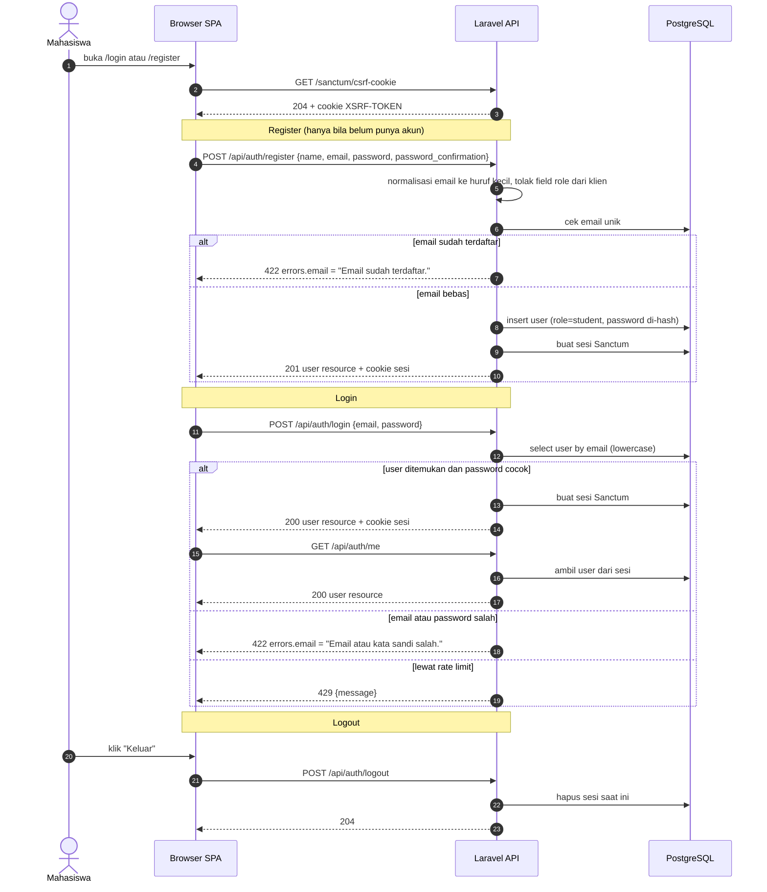

# 01 — Autentikasi (SPA Cookie)

**Sumber:** docs/API.md §1, §2 · docs/SECURITY.md
**Owner:** Orang A · **Task:** T1.1 (frontend T1.2 belum)
**Status:** ✅ ada (backend register/login/logout/me, T1.1)

## Prasyarat

- `users` + `users.role` (hanya `student`), `personal_access_tokens` untuk Sanctum.
- Sesi berbasis **cookie** (`withCredentials: true`), CSRF lewat `GET /sanctum/csrf-cookie`.
- Rate limit `skillbridge.rate_limits.auth_per_minute` (default 5/menit per email + IP).

## Diagram

## Aturan turunan

1. **Tanpa token di body.** Autentikasi pakai cookie sesi + header `X-XSRF-TOKEN`; tidak ada bearer token yang dikirim atau disimpan di frontend.
2. **Urutan wajib**: `GET /sanctum/csrf-cookie` dulu, baru request POST/PATCH/DELETE.
3. **`role` selalu `student`.** Field `role` dari klien diabaikan; tidak ada endpoint promotions.
4. **Normalisasi email**: huruf kecil sebelum cek dan simpan.
5. **Pesan login tidak membocorkan keberadaan akun**: salah email dan salah password memakai pesan yang sama.
6. **Bentuk error**: `{ "message": "...", "errors": { "field": ["..."] } }` dengan status 422/429; teks bahasa Indonesia.
7. **Logout menghapus sesi** dan mengembalikan 204 tanpa body.

## Catatan implementasi

- Endpoint yang ada: `POST /api/auth/register`, `POST /api/auth/login`, `POST /api/auth/logout`, `GET /api/auth/me`.
- Halaman `/login` dan `/register` belum ada (T1.2, milik Orang C).
- Rate limit endpoint auth dikonfigurasi di `config/skillbridge.php` (`auth_per_minute`).
