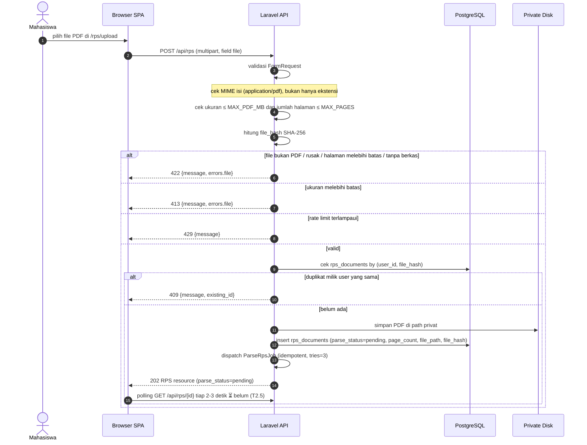

# 02 — Upload RPS (PDF)

**Sumber:** docs/API.md §3 · docs/DATABASE.md §`rps_documents` · docs/SECURITY.md
**Owner:** Orang A · **Task:** T2.2 (frontend T2.6 belum)
**Status:** ✅ ada (backend upload, T2.2)

## Prasyarat

- Pengguna terautentikasi (Sanctum cookie).
- Batas dari `config/skillbridge.php`: `SKILLBRIDGE_MAX_PDF_MB` (default 10), `SKILLBRIDGE_MAX_PAGES`, `SKILLBRIDGE_UPLOAD_PER_MINUTE` (default 10/menit per user).
- Disk privat di luar web root; `file_hash` = SHA-256 untuk deteksi duplikat per user.

## Diagram

## Aturan turunan

1. **Validasi isi, bukan ekstensi.** MIME dicek dari isi file (`application/pdf`); PDF rusak ditolak 422.
2. **Batas dari env/config**, tidak angka hardcode: ukuran, jumlah halaman, rate limit upload.
3. **Duplikat = 409 + `existing_id`** (unik per user lewat index `(user_id, file_hash)`), bukan diam-diam overwrite.
4. **Berkas privat.** Disimpan di disk privat di luar web root; tidak pernah disajikan lewat URL statis.
5. **Upload selalu 202 + dispatch job.** Parsing tidak dilakukan di request HTTP.
6. **Penolakan tidak menyimpan berkas.** Validasi gagal → file tidak masuk disk dan tidak ada baris `rps_documents`.
7. **Pengguna lain = 404** (bukan 403) agar keberadaan dokumen tidak bocok.
8. **Endpoint baca belum ada.** `GET /api/rps/{id}` masih `⏳ belum` (T2.5), jadi polling progres parse belum bisa jalan sampai endpoint itu ada.

## Catatan implementasi

- Endpoint upload sudah ada di `backend/routes/api.php` (`POST /api/rps`) dengan modul `Modules/Rps`.
- Pemeriksaan file PDF memakai `smalot/pdfparser` untuk menghitung halaman saat validasi dan untuk mengekstraksi teks saat parsing.
- Halaman `/rps/upload` (dropzone, progress, notifikasi pemrosesan pihak ketiga) belum ada (T2.6, milik Orang C).
- Antara upload dan parse, `parse_status` bernilai `pending` lalu `parsing` (lihat diagram 03).
