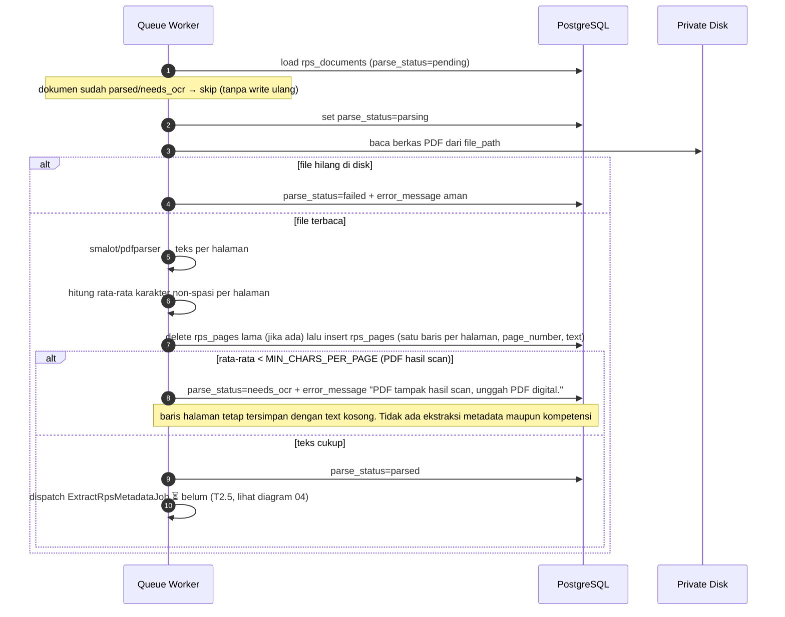

# 03 — Parse RPS (teks per halaman)

**Sumber:** docs/AI_PIPELINE.md §1 · docs/API.md §3, §6 · docs/DATABASE.md §`rps_pages`
**Owner:** Orang A · **Task:** T2.3
**Status:** ✅ ada (`ParseRpsJob`, T2.3)

## Prasyarat

- `rps_documents` sudah ada (upload T2.2 selesai) dan berkas tersimpan di disk privat.
- `config/skillbridge.php`: `SKILLBRIDGE_MIN_CHARS_PER_PAGE` (default 50, heuristik belum dikalibrasi).

## Diagram

## Aturan turunan

1. **Satu baris `rps_pages` per halaman**, dengan nomor halaman asli PDF; urutan halaman dijaga. Baris halaman **tetap ditulis** walau PDF hasil scan (teks kosong), lalu ditandai `needs_ocr`.
2. **Deteksi `needs_ocr`** memakai heuristik `min_chars_per_page`; nilainya placeholder dan **belum dikalibrasi** (JANGAN diklaim akurat).
3. **`needs_ocr` menghentikan rantai.** Tidak ada ekstraksi metadata maupun kompetensi untuk dokumen scan.
4. **Isi PDF tidak boleh masuk log.** Hanya status dan metadata teknis yang dicatat.
5. **Job idempotent**: `tries = 3`, backoff eksponensial, `failed()` → `parse_status = failed` + `error_message` aman (tanpa detail internal).
6. **Rerun parsing** pada dokumen yang sama **menghapus lalu menulis ulang** seluruh `rps_pages` (dalam satu transaksi), bukan upsert per halaman. Konsekuensi: `course_skills.page` dari parse lama bisa menunjuk isi halaman yang sudah berubah.
7. **Dokumen yang sudah `parsed`/`needs_ocr` di-skip** job parse; `WithoutOverlapping` mencegah dua parse untuk dokumen yang sama berjalan bareng.
8. **Penggantian model/heuristik** tidak mengubah status dokumen lama; itu proses baru.

## Catatan implementasi

- `ParseRpsJob` sudah ada (T2.3) dengan fixture PDF digital dan PDF tanpa teks.
- `GeminiClient` dan `ai_runs` tersedia (T2.4); `ExtractRpsMetadataJob` belum ada → diagram 04 dan 05 masih `⏳ belum`. `ParseRpsJob` **tidak** dispatch job metadata; placeholder di kode: "dispatched by Modules/Ai once available".
- Implementasi: `delete()` + `insert()` `rps_pages` dalam satu transaksi, `needs_ocr` dihitung setelah insert; skip bila `parse_status` sudah `parsed`/`needs_ocr`.
- Teks halaman dipakai ulang sebagai input ekstraksi metadata (halaman awal) dan ekstraksi kompetensi (semua halaman, lihat diagram 05).
