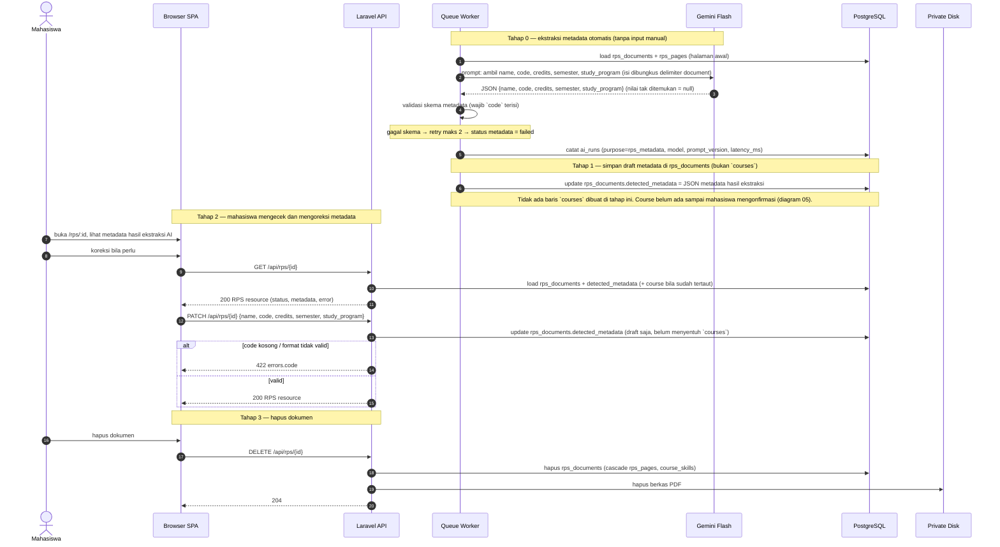

# 04 — Ekstraksi Metadata Mata Kuliah (oleh AI)

**Sumber:** docs/AI_PIPELINE.md §2 · docs/API.md §3 · docs/DATABASE.md §`courses`, §`rps_documents`
**Owner:** Orang B · **Task:** T2.5
**Status:** ⏳ belum (parse T2.3 ✅ ada, `ai_runs` T2.4 belum)

## Prasyarat

- `rps_documents.parse_status = parsed` dan `rps_pages` terisi (diagram 03).
- `ExtractRpsMetadataJob` dipicu `ParseRpsJob` setelah parse sukses (`ARCHITECTURE.md` §5).
- `ai_runs` (T2.4) untuk pencatatan setiap panggilan Gemini.
- Metadata = atribut **mata kuliah** (`courses`), bukan atribut dokumen; dokumen mereferensikannya lewat `rps_documents.course_id`.

## Diagram

## Aturan turunan

1. **Metadata diisi AI, bukan form manual.** `ExtractRpsMetadataJob` membaca halaman awal PDF; mahasiswa hanya mengecek dan mengoreksi lewat `PATCH /api/rps/{id}`.
2. **Ekstraksi metadata tidak membuat `courses`.** Job menyimpan hasil ke draft di `rps_documents.detected_metadata` (JSONB). `courses` dibuat **hanya** saat konfirmasi (diagram 05). Dokumen yang tidak pernah dikonfirmasi tidak meninggalkan baris `courses` yatim.
3. **Kode mata kuliah unik global.** `courses.code` tidak boleh duplikat; `code` cukup jadi identitas karena kode berbeda antar universitas. Saat **konfirmasi**, lookup `courses` by `code`: sudah ada → pakai baris itu (reuse), belum ada → insert baru. Nama boleh duplikat antar dokumen.
4. **Satu RPS → satu `courses`.** `rps_documents.course_id` diisi saat konfirmasi metadata (diagram 05), bukan saat ekstraksi.
5. **Prompt aman**: isi dokumen dibungkus delimiter dan dinyatakan sebagai DATA, bukan instruksi.
6. **Nilai tak ditemukan = `null`**, bukan tebakan. Metadata tidak lengkap tetap boleh jadi draft; konfirmasi `POST /api/rps/{id}/extract` yang menolak.
7. **Validasi mendahului penyimpanan**: skema gagal → retry maks 2 → status `failed` + `error_message` aman. Field `code` wajib terisi; draft tanpa `code` tidak bisa dikonfirmasi.
8. **Pencatatan AI** (T2.4): `ai_runs` dengan `purpose = rps_metadata`.
9. **Job idempotent**, `tries = 3`, backoff eksponensial, `failed()` menangani status.
10. **Hapus dokumen** cascade ke `rps_pages` dan `course_skills`; berkas PDF di disk ikut terhapus. `courses` **tidak** ikut terhapus: baris itu milik mata kuliah dan bisa dipakai dokumen lain.
11. **Akses hanya pemilik** (Policy). Dokumen milik orang lain → 404.

## Catatan implementasi

- `GET /api/rps` (daftar dokumen), `GET /api/rps/{id}`, `PATCH /api/rps/{id}`, `DELETE /api/rps/{id}` belum ada (T2.5).
- Migration unique `courses.code`: `backend/database/migrations/2026_11_10_100003_add_unique_code_to_courses_table.php`.
- **Butuh kolom baru** `rps_documents.detected_metadata` (JSONB, nullable) sebagai wadah draft metadata sebelum konfirmasi. Belum ada di `docs/DATABASE.md` maupun migration → usul ke A, tercatat sebagai gap `docs/DIAGRAMS.md §5`.
- **Gap:** tidak ada penanda metadata sudah dikonfirmasi (mis. `metadata_confirmed_at`); pembeda saat ini hanya `course_id` terisi atau tidak, ditambah `review_status`.
