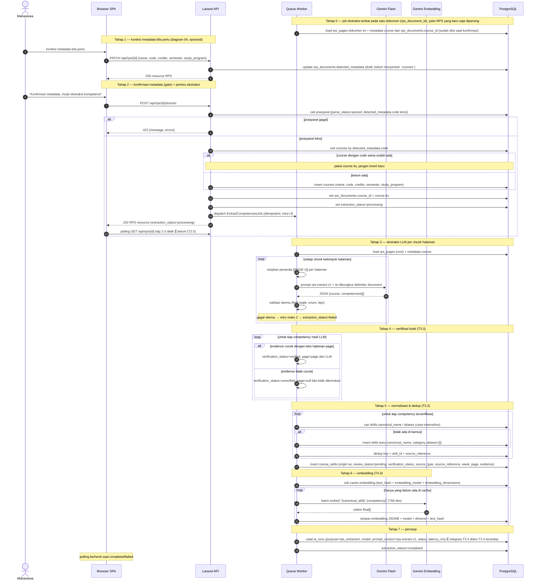

# 05 — Ekstraksi Kompetensi (RPS)

**Sumber:** docs/API.md §3 · docs/AI_PIPELINE.md §1, §3, §4
**Owner:** Orang B · **Task:** T3.4 (bukan T3.2 `SkillNormalizer`, T3.3 `EvidenceVerifier`, T4.3 embedding, T2.4 `ai_runs`)
**Status:** ⏳ belum (upload T2.2 + parse T2.3 ✅ ada)

## Prasyarat

- `rps_documents.parse_status = parsed` (bukan `needs_ocr`).
- Metadata mata kuliah **diekstrak AI** dari PDF (`ExtractRpsMetadataJob`, T2.5); pengguna boleh mengoreksinya lewat `PATCH /api/rps/{id}` sebelum konfirmasi.
- `rps_pages` terisi (satu baris per halaman).
- Endpoint pemicu: `POST /api/rps/{id}/extract` → **202** + resource. Hasil dibaca lewat `GET /api/rps/{id}/competencies`.

## Diagram

## Aturan turunan

1. **Metadata draft dipisah dari `courses`.** Metadata milik tabel `courses`; dokumen RPS menyimpan draft hasil ekstraksi di `rps_documents.detected_metadata` dan mereferensikan course final lewat `rps_documents.course_id` (diisi saat konfirmasi). Metadata **diekstrak AI** dari PDF oleh `ExtractRpsMetadataJob` (T2.5); pengguna hanya mengecek dan mengoreksi lewat `PATCH /api/rps/{id}`, yang juga menulis ke draft. Tidak ada langkah "user mengisi form metadata" sebelum ekstraksi.
2. **Ekstraksi metadata hanya menyimpan draft.** `ExtractRpsMetadataJob` menulis ke `rps_documents.detected_metadata`, **bukan** ke `courses`. Baris `courses` baru dibuat saat konfirmasi (`POST /api/rps/{id}/extract`): lookup `courses` by `code` — sudah ada → pakai baris itu (reuse), belum ada → insert baru. Dokumen yang tidak pernah dikonfirmasi tidak pernah menghasilkan baris `courses`.
3. **Kode mata kuliah unik global.** `courses.code` tidak boleh duplikat (kode berbeda antar universitas, jadi `code` cukup sebagai identitas). `detected_metadata.code` **wajib terisi**; draft tanpa `code` tidak bisa dikonfirmasi. Nama boleh sama antar dokumen — dua RPS untuk MK "Basis Data" tetap dua course selama `code` berbeda.
3. **Satu RPS → satu `courses`.** Setiap dokumen RPS mereferensikan tepat satu `courses` lewat `rps_documents.course_id` (diisi saat konfirmasi). Kompetensi menempel ke dokumen lewat `course_skills.rps_document_id`, bukan ke `course_id`. Satu `courses` boleh dipakai beberapa dokumen; kompetensi tiap dokumen tetap terpisah.
4. **Konfirmasi metadata adalah gate.** `POST /api/rps/{id}/extract` = konfirmasi metadata **dan** mulai ekstraksi kompetensi (API.md §4). Ekstraksi kompetensi tidak boleh jalan sebelum metadata ada. Saat itu terjadi: course di-resolve/dibuat, `rps_documents.course_id` diisi, `extraction_status=processing` diset, job di-dispatch — semuanya dalam satu transaksi sebelum dispatch.
5. **Bukti wajib.** `evidence` = kutipan persis dari dokumen, tidak diparafrasekan. `evidence` hanya boleh `null` untuk `origin = user` (T3.6), bukan untuk hasil AI.
6. **Verifikasi bukti** (T3.3): normalisasi (trim, kolaps spasi, samakan tanda kutip/hubung), lalu cek `evidence` merupakan substring teks halaman `page`; bila `page = null`, cek ke seluruh dokumen.
7. Bukti tidak cocok → `verification_status = unverified` **dan** `page` tidak dipercaya (set `null` bila tidak ketemu). `unverified` berarti maksimum klasifikasi `partial` (lihat diagram 08).
8. **Normalisasi istilah** (T3.2): cocokkan `skill` ke `skills.canonical_name`/`aliases` case-insensitive (contoh: `PHP Laravel` → `Laravel Framework`, `RESTful API` → `REST API`). Tidak ada cocok → buat entri `skills` baru (dapat ditinjau nanti).
9. **Dedup**: satu `course_skills` per pasangan (`skill_id` + `source_reference`) dalam satu dokumen.
10. **Embedding** (T4.3): teks yang di-embed adalah deskripsi, bukan nama saja: `"{canonical_skill}: {competency}"`. Model & dimensi harus sama dengan sisi lowongan (`gemini-embedding-001`, 768).
11. **Cache embedding**: panggil API hanya untuk yang `text_hash + embedding_model + embedding_dimensions` belum ada; pakai batch.
12. **Prompt `rps-extract-v1`**: isi dokumen dibungkus delimiter `document` dan dinyatakan sebagai DATA, bukan instruksi. Skema output persis `AI_PIPELINE.md §3` (field `skill`, `category`, `competency`, `evidence`, `source_type`, `source_reference`, `week`, `page`).
13. **Validasi mendahului penyimpanan**: skema gagal → retry maks 2 → `extraction_status = failed` + `error_message` aman (tanpa detail internal).
14. **Pencatatan AI** (T2.4): setiap panggilan dicatat di `ai_runs` (`purpose = rps_metadata` dan `purpose = rps_extraction`, `prompt_version`, `subject` = rps_document).
15. **Job wajib idempotent**, `tries = 3`, backoff eksponensial, `failed()` → set `extraction_status = failed` + pesan aman.
16. **Privasi**: isi PDF tidak boleh masuk log. Kirim ke Gemini hanya teks yang diperlukan.
17. **Reminder**: halaman `[[PAGE n]]` hanya penanda internal prompt; nomor halaman di `course_skills.page` harus integer asli dari penanda tersebut.

## Catatan implementasi

- `ExtractCompetenciesJob` dieksekusi di `QW`; `API` hanya menulis status dan meneruskan.
- Setelah upload, `ParseRpsJob` (T2.3) sudah mengisi `rps_pages`; diagram 03.
- `ExtractRpsMetadataJob` (T2.5) mengisi metadata otomatis; `POST /api/rps/{id}/extract` menolak (422) kalau metadata belum terisi — aturan eksplisitnya belum ada di `API.md`, masuk daftar gap `docs/DIAGRAMS.md §5`.
- Job ekstraksi selalu terikat pada `rps_document_id` satu dokumen: kompetensi hanya diekstrak dari RPS yang sedang diproses, tidak pernah ikut course lain yang kebetulan `code`-nya sama.
- **Butuh kolom baru** `rps_documents.detected_metadata` (JSONB, nullable) untuk draft metadata sebelum konfirmasi. Belum ada di `docs/DATABASE.md` maupun migration → usul ke A, tercatat sebagai gap `docs/DIAGRAMS.md §5`.
- Implementasi kode saat ini (`ParseRpsJob.php:102`) belum dispatch `ExtractRpsMetadataJob`; rantai upload → parse → metadata belum tersambung.
- `POST /api/rps/{id}/extract` (konfirmasi + pemicu) dan `GET /api/rps/{id}` untuk polling belum ada (T2.5/T3.4).
