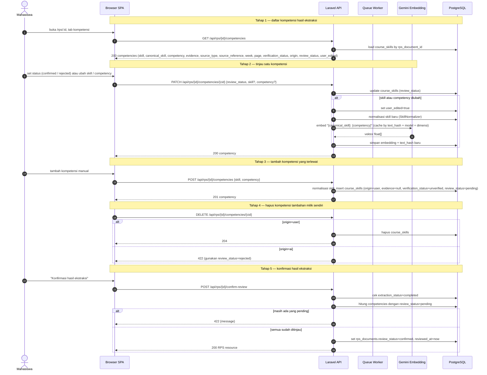

# 06 — Tinjau & Konfirmasi Kompetensi

**Sumber:** docs/API.md §3 · docs/AI_PIPELINE.md §3, §6 · docs/DATABASE.md §`course_skills`, §`rps_documents`
**Owner:** Orang B (backend) · Orang C (UI) · **Task:** T3.6 (frontend T3.5)
**Status:** ⏳ belum (ekstraksi T3.4 belum ada)

## Prasyarat

- `rps_documents.extraction_status = completed` dan `course_skills` terisi (diagram 05).
- Kolom `course_skills.origin`, `review_status`, `user_edited` serta `rps_documents.review_status`, `reviewed_at` (T3.6).
- `SkillNormalizer` (T3.2) dan `EmbeddingService` (T4.1) untuk kasus tambah/edit.

## Diagram

## Aturan turunan

1. **`rejected` tetap dikirim ke klien** agar bisa dipulihkan, tetapi **tidak** dipakai sebagai kandidat analisis (diagram 08).
2. **Kompetensi `origin = user`** punya `evidence = null` dan `verification_status = unverified` → maksimal klasifikasi `partial`.
3. **Edit memicu embedding ulang** dengan teks `"{canonical_skill}: {competency}"`; `user_edited = true` menandai baris yang berubah.
4. **Hapus hanya berlaku untuk `origin = user`.** Hasil AI dibuang lewat `review_status = rejected`, bukan dihapus.
5. **Konfirmasi butuh dua syarat**: `extraction_status = completed` **dan** tidak ada kompetensi `pending`. Gagal → 422 dengan pesan ramah.
6. **Analisis mensyaratkan `review_status = confirmed`** pada dokumen RPS; jika belum → 422 (diagram 08).
7. **Akses hanya pemilik** (Policy); dokumen/kompetensi milik orang lain → 404.
8. **Bukti tidak boleh diedit menjadi bukti baru.** `evidence` milik hasil AI tetap apa adanya; koreksi hanya pada `skill` dan `competency`.

## Catatan implementasi

- Kolom & enum untuk review **sudah ada**: `course_skills.origin`, `course_skills.review_status`, `course_skills.user_edited`, `rps_documents.review_status`, `rps_documents.reviewed_at` (migration + `App\Enums\CompetencyOrigin`, `CompetencyReviewStatus`, `App\Modules\Rps\Enums\ReviewStatus`). T3.6 yang tersisa: endpoint review (`PATCH/POST/DELETE .../competencies`, `POST /api/rps/{id}/confirm-review`), aturan status `confirmed`, dan integrasi ke `RunAnalysisJob`.
- Embedding ulang saat edit bisa dijalankan inline pada request ( seperti di atas) atau lewat job, asalkan model dan dimensi sama dengan sisi lowongan.
- Komponen UI: `CompetencyReviewTable`, badge status verifikasi, tombol konfirmasi (T3.5, milik Orang C).
