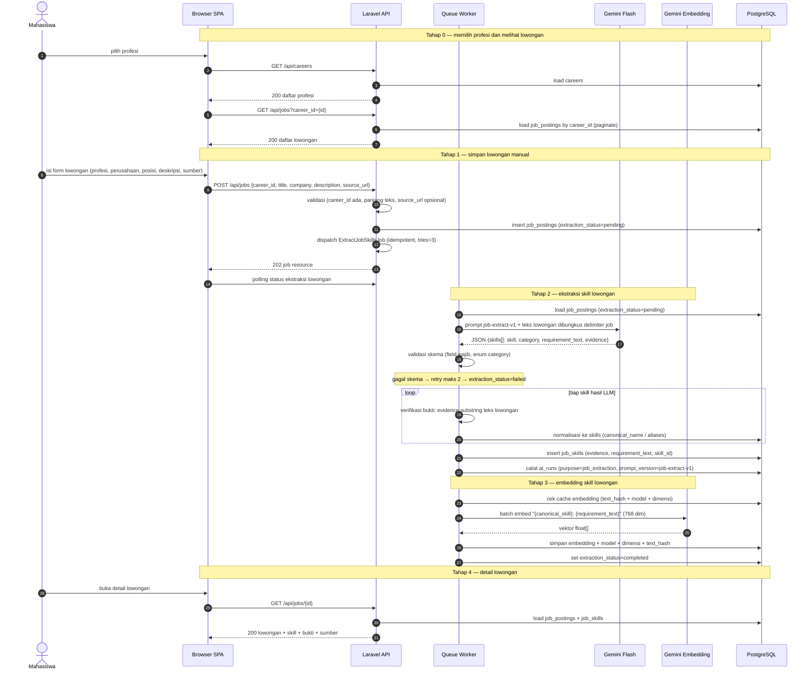

# 07 — Skill Lowongan Kerja

**Sumber:** docs/API.md §4 · docs/AI_PIPELINE.md §5, §4 · docs/DATABASE.md §`job_postings`, §`job_skills`
**Owner:** Orang B · **Task:** T5.3 (frontend T5.4 belum)
**Status:** ⏳ belum (migrasi T5.1 ✅ ada, import T5.2 ✅ ada)

## Prasyarat

- `careers` terisi (seeder profesi T5.1).
- `ExtractJobSkillsJob` memakai prompt `job-extract-v1` dan `EmbeddingService` (T4.1).
- `POST /api/jobs` menerima `career_id`, `title`, `company`, `description`, `source_url` opsional; teks dibatasi (mis. 20.000 karakter).

## Diagram

## Aturan turunan

1. **Prompt aman**: teks lowongan dibungkus delimiter dan dinyatakan sebagai DATA, bukan instruksi.
2. **Satu skill per item.** Daftar teknologi dipisah menjadi item terpisah (Laravel, REST API, Redis, Docker).
3. **Bukti wajib persis** dari teks lowongan, diverifikasi sebagai substring; tidak cocok → `unverified`.
4. **Normalisasi ke kamus `skills`** yang sama dengan sisi RPS (T3.2), supaya perbandingan bermakna.
5. **Embedding sisi lowongan** memakai teks deskripsi (`"{canonical_skill}: {requirement_text}"`), bukan nama skill saja, dengan model dan dimensi yang sama seperti sisi RPS.
6. **Cache embedding** dipakai lintas `course_skills` dan `job_skills` lewat `text_hash + model + dimensi`.
7. **Soft skill umum dan benefit diabaikan**, kecuali berbentuk kompetensi teknis.
8. **Pencatatan AI** di `ai_runs` (`purpose = job_extraction`).
9. **Job idempotent**, `tries = 3`, backoff eksponensial, `failed()` → `extraction_status = failed` + pesan aman.

## Catatan implementasi

- `GET /api/careers`, `GET /api/jobs`, `GET /api/jobs/{id}`, `POST /api/jobs` belum ada (T5.3).
- Perintah `skillbridge:import-jobs` (T5.2) sudah bisa mengisi `job_postings` dari CSV/JSON. **Gap:** import itu belum memicu `ExtractJobSkillsJob`, jadi lowongan hasil import tidak punya skill sampai ada pemicu lain.
- Teks lowongan diproses sebagai data tidak tepercaya: panjang dibatasi dan tidak boleh masuk log.
