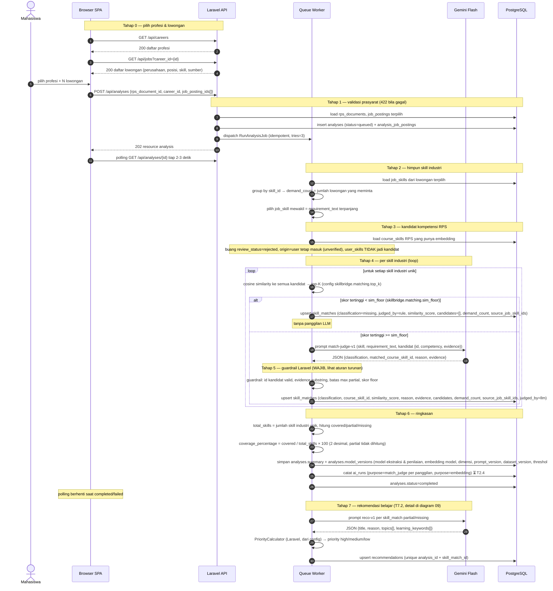

# 08 — Analisis & Klasifikasi Skill Gap

**Sumber:** docs/API.md §5 · docs/AI_PIPELINE.md §4, §6, §7
**Owner:** Orang B · **Task:** T6.2 `CandidateFinder`, T6.3 `MatchJudge` + guardrails, T6.4 `RunAnalysisJob` (+ T7.2 `GenerateRecommendationsJob` sebagai tahap lanjutan)
**Status:** ⏳ belum (T6.1 migrasi ✅ ada, T7.1 `PriorityCalculator` ✅ ada)

## Prasyarat

- `rps_documents.extraction_status = completed` **dan** `rps_documents.review_status = confirmed` (konfirmasi hasil ekstraksi, T3.6).
- Semua `job_postings` terpilih: `extraction_status = completed`.
- Semua `job_posting_ids` pada request punya `career_id` yang sama dengan `career_id` pada request.
- Melanggar salah satu → **422**.
- Endpoint: `POST /api/analyses` body `{ "rps_document_id", "career_id", "job_posting_ids": [...] }` → **202** + resource. Status dibaca lewat `GET /api/analyses/{id}` (polling 2–3 detik).

## Diagram

## Aturan turunan

1. **Prasyarat 422 persis empat butir**: `rps_documents.extraction_status = completed`; `rps_documents.review_status = confirmed`; semua lowongan terpilih `extraction_status = completed`; semua lowongan terpilih satu `career_id` yang sama dengan request.
2. **Satu analisis = satu RPS + satu profesi + satu atau lebih lowongan.** Skill yang sama dari beberapa lowongan digabung jadi satu baris `skill_matches` dengan `demand_count` (unique `analysis_id + skill_id`).
3. **Per aggregasi skill industri**: `demand_count` = jumlah lowongan terpilih yang meminta skill itu; vektor pembanding = `job_skill` dengan `requirement_text` paling informatif (terpanjang).
4. **Kandidat** = semua `course_skills` dari RPS terpilih yang punya embedding, **kecuali** `review_status = rejected`. Kompetensi `origin = user` ikut, tetapi `unverified` → hasil maksimal `partial`. `user_skills` **tidak** memengaruhi klasifikasi.
5. **Top-K dan floor dari config** (`skillbridge.matching.top_k`, `sim_floor`), bukan hardcode. Nilai env saat ini **placeholder, belum dikalibrasi** — jangan diklaim akurat.
6. **Skor < `sim_floor` → `missing` by rule**, `judged_by = rule`, tanpa panggilan LLM (hemat biaya).
7. **Guardrail (WAJIB, di Laravel — bukan di prompt)**:
   - `matched_course_skill_id` harus salah satu id kandidat top-K.
   - `evidence` harus substring dari bukti/teks kandidat terpilih; tidak cocok → turunkan ke `partial` dan kosongkan `evidence`.
   - Skill kategori `language|framework|tool`: bila nama teknologi atau alias-nya tidak muncul pada kompetensi/bukti kandidat → maksimal `partial`.
   - Kandidat `unverified` tidak boleh menghasilkan `covered` → maksimal `partial`.
   - Skor < `sim_floor` tidak boleh menghasilkan selain `missing`.
8. **Skor similarity = kandidat, bukan keputusan.** Tidak boleh ditampilkan sebagai persen penguasaan; label UI "Kemiripan semantik", hanya di panel detail.
9. **Coverage**: `coverage_percentage = covered / total_skills × 100`, dibulatkan 2 desimal. `partial` **tidak** dihitung sebagai covered. Label UI: "Cakupan skill dalam RPS".
10. **`model_versions` wajib diisi** di `analyses`: model ekstraksi, model penilaian, embedding model + dimensi, versi prompt, `dataset_version`, dan threshold yang dipakai.
11. **`ai_runs`**: setiap panggilan LLM dicatat (T2.4), termasuk yang dilewati karena skor di bawah floor (tidak ada panggilan → tidak ada baris; jangan mencatat panggilan palsu).
12. **Rekomendasi hanya untuk `partial`/`missing`**, kecuali skill yang `skill_id`-nya ada di `user_skills` pengguna (skill itu masuk `meta.self_declared_skills`, bukan `data`). Detail di diagram 09.
13. **Job wajib idempotent**, `tries = 3`, backoff eksponensial, `failed()` → `analyses.status = failed` + `error_message` aman.
14. **Copy UI**: "Tercakup dalam RPS", "Belum ditemukan dalam RPS". Jangan "Anda belum menguasai" / "persentase penguasaan".

## Catatan implementasi

- `CandidateFinder` (T6.2) = cosine + top-K. `Support/Cosine` (T4.2) menghitungnya; embedding di kedua sisi harus memakai model & dimensi yang sama.
- `MatchJudge` (T6.3) = pemanggilan LLM + guardrail; guardrail adalah kode Laravel, bukan prompt.
- Prompt `match-judge-v1` membungkus kandidat & requirement sebagai DATA di dalam delimiter `<candidates>` / `<requirement>`.
- `RunAnalysisJob` (T6.4) setelah selesai memicu `GenerateRecommendationsJob` (T7.2) — urutan dispatch masih menjadi gap (`docs/DIAGRAMS.md §5`).
