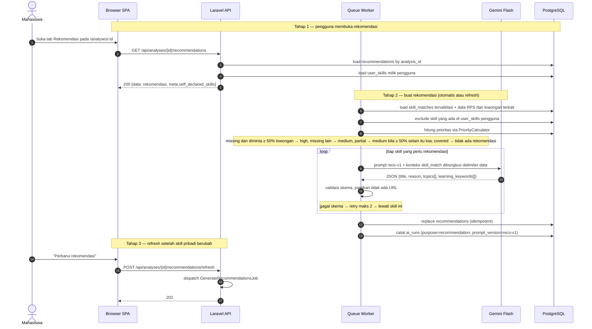

# 09 — Rekomendasi Belajar Mahasiswa

**Sumber:** docs/API.md §5 · docs/AI_PIPELINE.md §7 · docs/DATABASE.md §`recommendations`
**Owner:** Orang B · **Task:** T7.2, T7.3 (frontend T7.4 belum)
**Status:** ⏳ belum (`PriorityCalculator` T7.1 ✅ ada)

## Prasyarat

- `skill_matches` sudah ada dan tervalidasi dari analisis (`analyses.status = completed`, diagram 08).
- `GenerateRecommendationsJob` memakai prompt `reco-v1`; ambang prioritas di `config('skillbridge.recommendation.priority')`.
- `user_skills` (T7.5) untuk pengecualian skill pribadi — lihat diagram 10.

## Diagram

## Aturan turunan

1. **Input hanya `skill_matches` yang sudah divalidasi.** Data RPS dan lowongan hanya sebagai konteks pendukung.
2. **Prioritas dihitung Laravel**, bukan LLM. LLM hanya menyusun `title`, `reason`, `topics`, `learning_keywords`.
3. **Tidak boleh ada URL.** Rekomendasi berisi topik dan kata kunci belajar saja, tanpa tautan yang tidak diverifikasi.
4. **Skill pribadi dikeluarkan.** Skill yang ada di `user_skills` tidak dibuatkan rekomendasi; muncul di `meta.self_declared_skills` dengan label "Dipelajari mandiri (dilaporkan pengguna)".
5. **Refresh idempotent**: rekomendasi lama diganti, bukan ditumpuk. Klasifikasi dan `summary` **tidak** dihitung ulang.
6. **Bahasa aman untuk mahasiswa**: jangan menyiratkan mahasiswa belum menguasai skill; nyatakan hanya bahwa skill belum ditemukan di RPS.
7. **Pencatatan AI** di `ai_runs` (`purpose = recommendation`).
8. **Job idempotent**, `tries = 3`, backoff eksponensial, `failed()` tidak boleh meninggalkan rekomendasi setengah jadi.

## Catatan implementasi

- `PriorityCalculator` sudah ada (T7.1) dengan ambang dari `config('skillbridge.recommendation.priority')` (`SKILLBRIDGE_PRIORITY_HIGH_DEMAND_RATIO`, default 0.5).
- Penanda skill "wajib (*required*)" dari PRD §5.3 belum dipakai karena `job_skills` tidak menyimpannya.
- **Gap:** urutan dispatch `GenerateRecommendationsJob` belum jelas — otomatis dari `RunAnalysisJob` atau hanya lewat endpoint refresh; lihat `docs/DIAGRAMS.md §5`.
- `GET /api/analyses/{id}/recommendations` dan `POST .../recommendations/refresh` belum ada (T7.3, T7.5).
