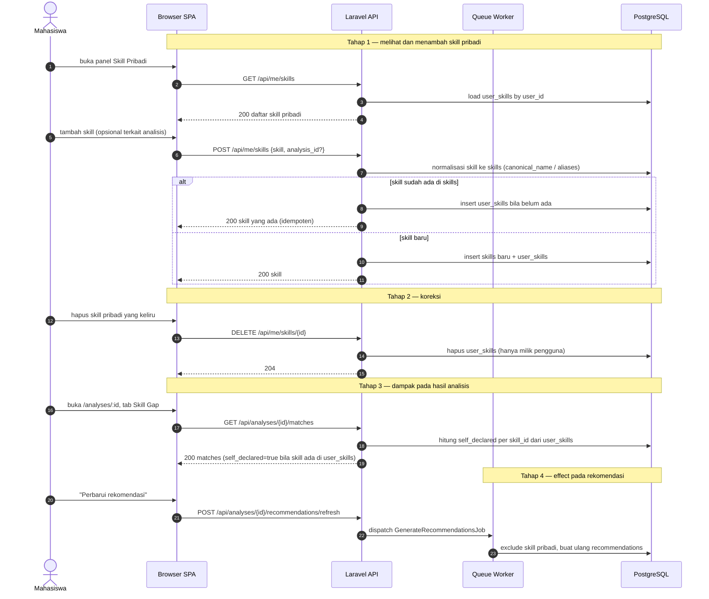

# 10 — Skill Pribadi (Dilaporkan Pengguna)

**Sumber:** docs/API.md §5 · docs/AI_PIPELINE.md §7 · docs/TASKS.md T7.5 · docs/PRD.md §5
**Owner:** Orang B (backend) · Orang C (UI) · **Task:** T7.5
**Status:** ⏳ belum

## Prasyarat

- Tabel `user_skills` (T7.5) dan `SkillNormalizer` (T3.2) tersedia.
- `skill_matches` sudah ada (diagram 08) dan `recommendations` (diagram 09) untuk melihat efeknya.

## Diagram

## Aturan turunan

1. **`self_declared` dihitung saat dibaca**, bukan disimpan di `skill_matches`. Sumbernya `user_skills` milik pengguna yang sedang login.
2. **`self_declared` tidak mengubah `classification` maupun `summary`.** Analisis tetap menggambarkan cakupan RPS.
3. **Klasifikasi tetap sama** setelah menambah skill pribadi; hanya rekomendasi yang berubah (diagram 09).
4. **Normalisasi lewat `SkillNormalizer`** yang sama dengan sisi RPS dan lowongan, supaya skill pribadi bisa dicocokkan dengan `skill_id`.
5. **Idempoten**: menambah skill yang sama dua kali tidak menduplikasi baris dan mengembalikan data yang sama.
6. **Akses hanya pemilik**: daftar dan hapus hanya milik pengguna yang login; baris orang lain tidak terlihat.
7. **Bahasa UI**: "dilaporkan pengguna" atau "Dipelajari mandiri (dilaporkan pengguna)", bukan "dikuasai".
8. **Skill pribadi bukan kandidat analisis** dan tidak memengaruhi klasifikasi (diagram 08).
9. **Refresh rekomendasi idempotent**: ganti yang lama, klasifikasi tidak dihitung ulang.

## Catatan implementasi

- Tabel `user_skills`, endpoint `GET/POST/DELETE /api/me/skills`, dan `meta.self_declared_skills` belum ada (T7.5).
- Komponen UI: `SelfDeclaredSkillAction`, `SelfDeclaredSkillsPanel` (T7.5, milik Orang C).
- Kolom `analysis_id` pada `POST /api/me/skills` opsional: dipakai untuk memunculkan aksi cepat dari halaman analisis.
